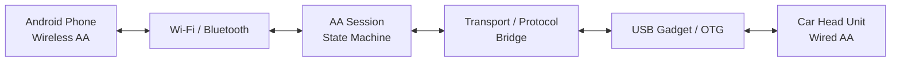
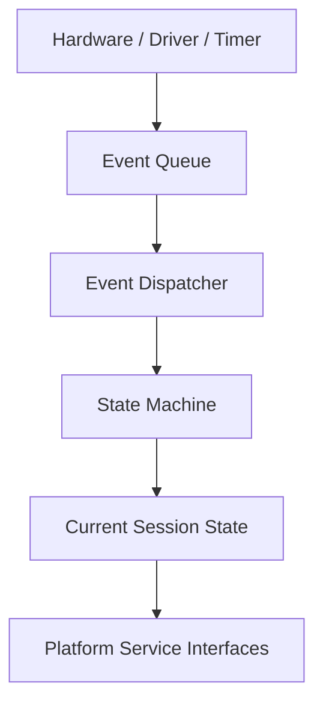
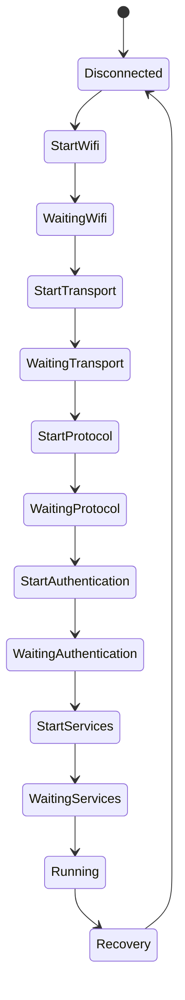

# aapi-wp-cpp

> A C++ implementation of a wireless Android Auto dongle, designed with the Raspberry Pi Zero 2 W in mind.

**Status:** early development / experimental.

The goal is to bridge a vehicle that exposes **wired Android Auto over USB** with an **Android phone using wireless Android Auto**. The Raspberry Pi sits in the middle and handles the connection lifecycle, wireless-side discovery/connectivity, and the transport bridge to the car's USB connection.

```text
                    wireless Android Auto
┌─────────────────┐                          ┌──────────────────┐
│   Android phone │                          │ Raspberry Pi     │
│                 │ ◄──── Wi-Fi / BT ──────► │ Zero 2 W         │
└─────────────────┘                          │                  │
                                             │  aapi-wp-cpp     │
                                             │                  │
                                             └────────┬─────────┘
                                                      │ USB / OTG
                                                      ▼
                                             ┌──────────────────┐
                                             │ Car head unit    │
                                             │ Wired Android AA │
                                             └──────────────────┘
```

The project is inspired by the open-source [WirelessAndroidAutoDongle](https://github.com/nisargjhaveri/WirelessAndroidAutoDongle) project and [aa-proxy-rs](https://github.com/aa-proxy/aa-proxy-rs). Those projects provide valuable reference material for the hardware topology, Android Auto connection flow, and proxying model. This repository is an independent C++ implementation with its own architecture and development goals.

## Why this project exists

Commercial wireless Android Auto adapters are readily available, but an open implementation is useful for learning, experimentation, debugging, and hardware/software control. The Raspberry Pi Zero 2 W is an especially interesting target because it combines USB OTG with Wi-Fi and Bluetooth in a small, inexpensive board.

The intended runtime model is:

1. the car head unit sees the Raspberry Pi as the wired Android Auto endpoint;
2. the Pi discovers and establishes the wireless-side connection with the Android phone;
3. Android Auto traffic is bridged between the wireless and USB sides;
4. the session state machine handles connection, readiness, failure, and recovery events.

The project is **not** an Android Auto head-unit implementation. It is a dongle/proxy intended to sit between an existing head unit and an Android phone.

## Current implementation

The current snapshot contains:

- a small event queue and dispatcher;
- a reusable state-machine core;
- a session state graph for connection setup and recovery;
- service interfaces for Bluetooth, Wi-Fi, USB, transport, protocol, timing, and logging;
- a dummy BLE adapter for host-side development;
- Linux/BlueZ-oriented driver implementations;
- an application shell;
- GoogleTest/GoogleMock tests;
- CMake/Ninja development builds;
- an AArch64 Buildroot integration targeting the Raspberry Pi Zero 2 W;
- Docker-based development/build tooling.

The Android Auto protocol and end-to-end hardware path are **not complete** yet.

## Architecture

The software is deliberately split so that connection/session behavior can be developed without requiring a Raspberry Pi, Bluetooth controller, Wi-Fi interface, or car head unit for every test.



Inside the application, the session is driven by events:



The current lifecycle is approximately:



The state machine is an implementation detail of the dongle's connection lifecycle. It is not the purpose of the project by itself.

## Hardware target

The primary target is the **Raspberry Pi Zero 2 W**.

The intended physical connection is:

```text
Pi Zero 2 W USB/OTG port
          │
          │ USB data
          ▼
     car head unit
```

The Pi's Wi-Fi and Bluetooth radios provide the wireless side of the dongle. The USB OTG interface provides the wired Android Auto connection to the vehicle.

The repository already contains an AArch64 Buildroot configuration for the Zero 2 W. Hardware validation is still ahead of the current development checkpoint.

## Repository layout

```text
inc/
  core/                 Event and state-machine interfaces
  services/             Platform service contracts
  session/              Android Auto connection/session states
  drivers/ble/           BLE interfaces and adapters
  drivers/linux/         Linux/BlueZ service implementations
  transport/             Transport abstractions

src/
  core/                 Event and state-machine implementation
  session/              Session implementation and states
  drivers/ble/          BLE adapter implementations
  drivers/linux/        Linux/BlueZ implementations
  app/                  Application entry point

protocol/               Protocol build/development area
services/               Service-layer build configuration

tests/                  GoogleTest/GoogleMock tests
cmake/                  Shared CMake configuration
scripts/                Development convenience scripts
docker/                 Development and Buildroot containers
buildroot/              Raspberry Pi Zero 2 W integration
docs/                   Project documentation
```

## Development

### Host build

The project uses CMake and Ninja.

```bash
./scripts/configure.sh debug
./scripts/build.sh debug
```

Or directly:

```bash
cmake --preset Debug-host
cmake --build --preset host-debug
```

### Tests

```bash
./scripts/test.sh debug
```

The test suite currently exercises the event/state-machine core, session states, and BLE development components.

### Formatting and static analysis

```bash
./scripts/check-format.sh
./scripts/tidy.sh
./scripts/all.sh
```

See [`docs/development.md`](docs/development.md) for the development workflow.

## Raspberry Pi / Buildroot

The embedded path is based on Buildroot and an AArch64 Raspberry Pi Zero 2 W configuration:

```text
C++ sources
    │
    ▼
CMake / cross compilation
    │
    ▼
Buildroot
    │
    ▼
Raspberry Pi Zero 2 W image
    │
    ▼
USB OTG + Wi-Fi + Bluetooth
```

This is deployment infrastructure, not yet a finished production image. The project still needs real hardware validation and an end-to-end Android Auto connection before the deployment story can be considered complete.

## Inspiration and related work

This project was inspired by:

- **WirelessAndroidAutoDongle** by Nisarg Jhaveri: the original Raspberry Pi-based wireless Android Auto dongle project and an important reference for the hardware topology and connection model.
- **aa-proxy-rs**: a later proxy implementation that bridges a wireless Android phone with a USB-connected car head unit and evolved from the `aawgd` component of WirelessAndroidAutoDongle.

Neither project is being presented as the implementation of this repository. They are references and sources of inspiration for an independent C++ implementation.

## Current status

The repository represents a development checkpoint rather than a working release.

Known limitations include:

- the Android Auto protocol implementation is incomplete;
- several platform services are skeletal;
- the Linux driver path depends on D-Bus/BlueZ development libraries;
- the host application currently couples `Session` to `LinuxServices`, creating a build/link dependency that needs to be cleaned up;
- the current application loop is intentionally minimal;
- the Raspberry Pi target has not yet been validated end-to-end with a real vehicle and phone.

The current CI linker failure is therefore documented as a known defect rather than hidden by the historical reconstruction.

## Reconstructed history

The repository history is being reconstructed from the current source snapshot into meaningful engineering milestones. The intention is to make the history explain how a wireless Android Auto dongle could have been developed, rather than merely grouping files by directory.

The current sequence is:

1. project purpose, hardware target, and architecture;
2. CMake/build and developer tooling;
3. behavioral tests for the core and session lifecycle;
4. event/state-machine implementation;
5. Android Auto session lifecycle;
6. service contracts and BLE development adapter;
7. application and transport scaffolding;
8. Linux/Raspberry Pi target integration;
9. documentation of the current checkpoint.

See [`docs/repository-history.md`](docs/repository-history.md).

## License

No project license has been declared yet.
