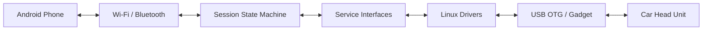

# Architecture

## Project boundary

`aapi-wp-cpp` is intended to be the software running on a small Linux SBC that acts as a **wireless Android Auto dongle**.

The system sits between two sides:

```text
Android phone                         Vehicle head unit
(wireless Android Auto)               (wired Android Auto)
        │                                      │
        │ Wi-Fi / Bluetooth                   │ USB / OTG
        ▼                                      ▲
        ┌──────────────────────────────────────┐
        │          Raspberry Pi Zero 2 W       │
        │                                      │
        │  connection/session management       │
        │  transport/protocol bridge           │
        │  platform drivers                     │
        └──────────────────────────────────────┘
```

The Pi is **not** intended to replace the car's Android Auto head unit. It is the bridge that makes a wired-only head unit usable with a wireless Android phone.

## Design goals

1. **Small embedded target**: the primary hardware target is Raspberry Pi Zero 2 W.
2. **Testable connection logic**: session behavior should be testable without physical hardware.
3. **Explicit lifecycle**: connection stages and recovery behavior should be visible in the state machine.
4. **Replaceable platform code**: Linux/Bluetooth/Wi-Fi/USB APIs should not leak into session logic.
5. **Incremental protocol work**: transport and protocol functionality can be developed independently of the session framework.
6. **Deployable Linux path**: the application should eventually be cross-compiled and packaged with Buildroot for the Pi.

## Layers

### Core

`src/core` contains generic event and state-machine mechanics:

- `Event` types represent asynchronous stimuli;
- `EventQueue` stores events;
- `EventDispatcher` drains events;
- `StateMachine` owns the current state and transitions.

This layer should know nothing about Android Auto, Bluetooth, Linux, or Raspberry Pi hardware.

### Session

`src/session` models the dongle's connection lifecycle.

The current states cover stages such as:

- disconnected;
- starting and waiting for Wi-Fi;
- starting and waiting for transport;
- starting and waiting for protocol;
- starting and waiting for authentication;
- starting and waiting for services;
- running;
- recovery.

The state graph is intended to make connection sequencing and failure recovery explicit.

### Services

`inc/services` defines contracts for platform capabilities:

- Bluetooth;
- Wi-Fi;
- USB;
- transport;
- protocol;
- timers;
- clock;
- logging;
- aggregate services.

These interfaces are important for host-side testing and for keeping the session independent from Linux APIs.

### Drivers

`src/drivers` contains platform implementations.

The BLE area includes a dummy adapter for development and tests, plus a Linux adapter. The Linux driver area contains BlueZ/D-Bus-oriented implementations for the platform services.

### Application

`src/app` is the executable boundary. It assembles the session and driver objects and owns the main loop.

The current application shell is intentionally small. It is not yet the finished dongle runtime.

### Deployment

`buildroot/` contains the beginning of the embedded deployment path, including an AArch64 configuration for Raspberry Pi Zero 2 W.

## Runtime flow

Conceptually, the system looks like this:



The exact Android Auto protocol/data path is still incomplete in the current snapshot. The architecture therefore describes the intended boundary rather than claiming an end-to-end implementation that does not yet exist.

## Event flow

External producers should communicate with the session through events rather than manipulating state directly:

```text
Driver / timer / transport event
              │
              ▼
        EventQueue
              │
              ▼
      EventDispatcher
              │
              ▼
        StateMachine
              │
              ▼
       Current State
              │
              ▼
      Service interfaces
```

This gives the session a clear synchronization boundary and makes event ordering observable in tests.

## Testing strategy

Tests are organized around observable behavior:

- core tests cover event queue, dispatcher, and state-machine mechanics;
- session tests cover state transitions and lifecycle behavior;
- BLE tests exercise the dummy adapter without requiring hardware;
- Linux driver tests cover selected platform behavior.

The intention is to keep most connection-state development runnable on a normal host machine.

## Hardware assumptions

The primary board is the Raspberry Pi Zero 2 W because it provides the combination required by the intended dongle design:

- USB OTG/gadget capability for the wired head-unit side;
- Wi-Fi for the wireless Android Auto transport;
- Bluetooth for discovery/pairing;
- enough CPU/RAM for the proxy/session workload.

The repository's Buildroot configuration targets the 64-bit Zero 2 W platform.

## Current architectural debt

The supplied snapshot has a known dependency problem: `Session` constructs and owns `LinuxServices` directly. The host configuration can disable the Linux driver target, but the application/session code still refers to Linux driver types.

That can produce linker errors such as missing Linux driver vtables and RTTI symbols.

The cleaner design is to inject the `IServices` dependency into `Session`, allowing:

```text
host tests  ──► fake services
host app    ──► development services
Pi target   ──► Linux services
```

This should be addressed as a future implementation change, not retroactively folded into the reconstructed history.
